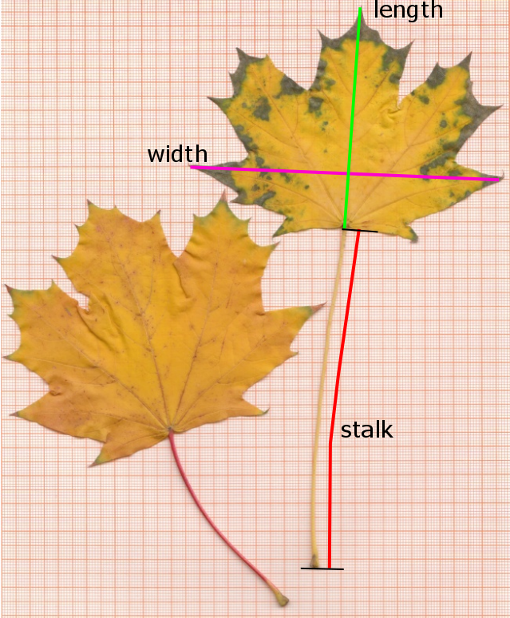

```{r setup, include=FALSE}
knitr::opts_chunk$set(echo = TRUE, eval=FALSE)
leaves <- read.csv("leaves.csv")
```

<!--
leaves <- read.csv("https://raw.githubusercontent.com/tpetzoldt/datasets/main/data/leaves.csv")
--->

```{r include=FALSE}
knitr::opts_chunk$set(eval = FALSE)
library("gplots", quietly=TRUE, warn.conflicts = FALSE)
library("dplyr")
library("ggplot2")
```

# Introduction

## Scientific aim

In this exercise, we will explore the distribution of leaf width in two samples of maple
leaves (*Acer platanoides*) that were collected with different sampling strategies — one
random and one subjective. We will identify the 95% prediction interval of individual
observations and the 95% confidence interval of the mean, and compare the two samples
with respect to variance and mean values using box plots, bar charts and classical
statistical tests. Finally, we will interpret the results with respect to the experimental
hypothesis that subjective sampling may introduce a sampling bias, leaving open whether
it prefers bigger or smaller leaves or affects the variance. We use the **leaf width** as
an example; an analysis of the other variables is left as an optional exercise.

From this hypothesis, we derive the following statistical hypotheses **about the variance:**

* $H_0$: The variance of both samples is the same.
* $H_a$: The samples have different variance.

**and about the mean:**

* $H_0$: The mean of both samples is the same.
* $H_a$: The mean values of the samples are different.

## Learning objectives

After completing this tutorial, you will be able to (1) inspect and check the distribution
of a sample using histograms and quantile-quantile plots, (2) calculate and distinguish
prediction intervals and confidence intervals, both nonparametric (empirical quantiles) and
parametric (normal and t-distribution), and (3) apply and interpret t-tests and F-tests,
including the assessment of effect size.


# Material and Methods

The data set consists of two samples of maple leaves (*Acer platanoides*), 
sampled in front of the institute building (Fig. 1).

{width=50%}

The two samples were collected with different sampling strategies:

 * HYB: hydrobiology group, got random sample from the supervisor
 * HSE: hydroscience group, had the freedom to collect their leaves themselves

Then length, width and stalk length were measured in millimeters with a ruler 
(Fig. 2) and the data collected in a spreadsheet table and a csv-file.

{width=25%}


The statistical analysis is performed with the **R** software for statistical 
computing and graphics [@RCore].

# Data Analysis

## Prepare and inspect data

The data set is available from your local learning management system (LMS,
e.g. OPAL at TU Dresden) or publicly from
[https://tpetzoldt.github.io/datasets/data/leaves.csv](https://tpetzoldt.github.io/datasets/data/leaves.csv).

* Download the data set `leaves.csv` and use one of RStudio's "Import Dataset" wizards.
* Alternative: use `read.csv()`.


```{r }
#  ... do it
```

* plot everything, just for testing:

```{r }
plot(leaves)
```

* First, let's apply a traditional approach and split `leaves` in two separate tables for the samples HSE and HYB:

```{r }
hyb <- subset(leaves, group == "HYB")
hse <- subset(leaves, group == "HSE")
```

* Then, compare leaf **width** of both groups graphically:

```{r }
boxplot(hse$width, hyb$width, names=c("HSE", "HYB"))
```

## Check distribution

```{r }
# use `hist`, `qqnorm`, `qqline`
# ...
```

Check if the distribution is roughly symmetric and bell-shaped and what would deviations imply for the tests.

## Sample statistics and prediction interval

In a first analysis, we want to estimate the interval that covers 95% of leaves, defined by their width.
As a first method, we take the **empirical quantiles** directly from the data. The method is also called "**nonparametric**," because we don't calculate mean and standard deviation and do not assume a normal or any other distribution.

```{r }
quantile(hse$width, p = c(0.025, 0.975))
```

Now, we compare this empirical result with a method that relies on a specific distribution.
If our initial graphical visualization (e.g., the histogram) suggests the data is reasonably symmetric and bell-shaped, we can proceed with a parametric assumption.

We first calculate mean, sd, N and se for "hse" data set:

```{r }
hse.mean <- mean(hse$width)
hse.sd   <- sd(hse$width)
hse.N    <- length(hse$width)
hse.se   <- hse.sd/sqrt(hse.N)
```

Then we estimate an approximate[^pred] two-sided 95% **prediction interval** ($PI$) for the sample using a simplified approach based on the quantiles of the theoretical normal distribution ($z_{\alpha/2} \approx 1.96$) and the sample parameters mean $\bar{x}$ and standard deviation ($s$):

$$
PI = \bar{x} \pm z \cdot s
$$

This is the interval where we would predict a new single observation to fall with 95% confidence.

```{r }
hse.95 <- hse.mean + c(-1.96, 1.96) * hse.sd
hse.95
```

Instead of using 1.96, we could also use the quantile function `qnorm(0.975)` for the upper interval or `qnorm(c(0.025, 0.975))` for the lower and upper in parallel:


```{r }
hse.95 <- hse.mean + qnorm(c(0.025, 0.975)) * hse.sd
hse.95
```

Now we plot the data and indicate the 95% interval:

```{r }
plot(hse$width)
abline(h = hse.95, col="red")
```

... and the same as histogram:

```{r }
hist(hse$width)
abline(v = hse.95, col="red")
rug(hse$width, col="blue")
```


## Confidence interval of the mean

The **confidence interval** ($CI$) of the mean tells us how precise a mean value was estimated from data.
If the sample size is "large enough", the distribution of the raw data does not necessarily need to be normal, because then mean values tend to approximate a normal distribution due to the **central limit theorem**[^skew].

The formula for the CI of the mean is: $$CI = \bar{x} \pm t_{\alpha/2, n-1} \cdot \frac{s}{\sqrt{N}}$$

### Confidence interval of the mean for the "hse" data

**Task:** Calculate the confidence interval of the mean value of the "hse" data set using the quantile function (`qt`) of the t-distribution[^twosigma]:

```{r }
hse.ci <- hse.mean + qt(p = c(0.025, 0.975), df = hse.N - 1) * hse.se
```

Now indicate the confidence interval of the mean in the histogram.

```{r eval=FALSE}
abline(v = hse.ci, col="magenta")
```

### Confidence interval for the mean of the "hyb" data


```{r }
#  Do the same for the "hyb" data, calculate mean, sd, N, se and ci.
# ...
```

### Discussion: Comparison and interpretation

Explain the fundamental statistical reason why the 95% Prediction Interval (PI) for the leaf width is always wider than the 95% Confidence Interval (CI) for the mean leaf width, even though both intervals are calculated from the same data set (hse).


## Comparison of the samples

To compare the two samples, we already created box plots at the beginning.
Instead of a boxplot, we can also use a bar chart with confidence intervals.  
This can be done with the add-on package **gplots** (not to be confused with **ggplot**):

**Solution A) with package gplots**

```{r }
library("gplots")
barplot2(height = c(hyb.mean, hse.mean),
         ci.l   = c(hyb.ci[1], hse.ci[1]),
         ci.u   = c(hyb.ci[2], hse.ci[2]),
         plot.ci = TRUE,
         names.arg=c("HYB", "HSE")
)
```

**Solution B) without add-on packages (optional)**

Here we use a standard bar chart, and line segments for the error bars.
One small problem arises, because `barplot` creates an own x-scaling.
The good news is, that `barplot` returns its x-scale.
We can store it in a variable, e.g. `x` that can then be used in subsequent code.

```{r }
x <- barplot(c(hyb.mean, hse.mean),
  names.arg=c("HYB", "HSE"), ylim=c(0, 150))
segments(x0=x[1], y0=hyb.ci[1], y1=hyb.ci[2], lwd=2)
segments(x0=x[2], y0=hse.ci[1], y1=hse.ci[2], lwd=2)
```


## Is the difference between the samples statistically significant?

In the following, we compare the two samples with t- and F-tests. We use Welch's test as the default because it does not require equal variances; the classical t-test and F-test are shown for comparison.
The F-test is additionally of interest in its own right, because it directly tests whether the two samples differ in variance

**Hypotheses:**

As formulated in the Introduction, we test separately (i) whether their means differ (t-tests), and (ii) whether the variances of the two samples differ (F-test).

```{r }
t.test(width ~ group, data = leaves)
```

Perform also the classical t-test (`var.equal = TRUE`) and the F-test (`var.test`).
Calculate absolute and relative effect size (mean differences) and interpret the results of all 3 tests. 
If the Welch test and the classical t-test lead to different conclusions, report the Welch test.

```{r }
# var.test(...)
# t.test(...)
# ...
```

# Appendix

The following is optional for all who feel underchallenged or just want to learn more.

## Calculation of summary statistics with **dplyr**

```{r }
library("dplyr")
leaves <- read.csv("leaves.csv")

stats <-
  leaves |>
    group_by(group) |>
    summarize(mean = mean(width), sd = sd(width),
              N = length(width), se = sd/sqrt(N),
              lwr = mean + qt(p = 0.025, df = N-1) * se,
              upr = mean + qt(p = 0.975, df = N-1) * se
             )

stats
```

## Barchart and errorbars with **ggplot2**

```{r }
library("ggplot2")
stats |>
  ggplot(aes(x=group, y=mean, min=lwr, max=upr))  +
    geom_col() + geom_errorbar(width=0.2)
```

[^twosigma]: **Two sigma rule:** Compare the t-quantile `qt` with the normal quantile 1.96 or an approximate 2.0.

[^pred]: **Approximate prediction intervals:** The simplified $\bar{x} \pm z \cdot s$ formula used above is an approximation. 
    A statistically rigorous 95% prediction interval, especially for smaller samples, needs two corrections.

    First, we would use the **t-distribution** with the quantile $t_{\alpha/2, n-1}$ (or `qt(alpha/2, n-1)` in R) instead of the normal quantiles ($\pm 1.96$). 
    Then we add a term $\sqrt{1+1/N}$ that corrects for the sample parameters. The full formula for a single future observation is then:

    $$\text{PI} = \bar{x} \pm t_{\alpha/2, n-1} \cdot s \cdot \sqrt{1 + \frac{1}{N}}$$

    The prediction interval is related to the so-called "tolerance interval".
    Both are the same if the population parameters $\mu, \sigma$ are known or the sample size is very big.
    However, there are theoretical and practical differences in case of small sample size.

[^skew]: **Limitations of the CLT** Note that for strongly skewed data — especially with small sample sizes — the confidence interval of the mean can be biased, because the sample mean and the sample variance are then correlated, so that the central limit theorem only applies slowly. In such cases it is recommended to transform the data (e.g., log-transform), calculate mean and CI on the transformed scale, and back-transform the results to the original scale afterwards.

# References

